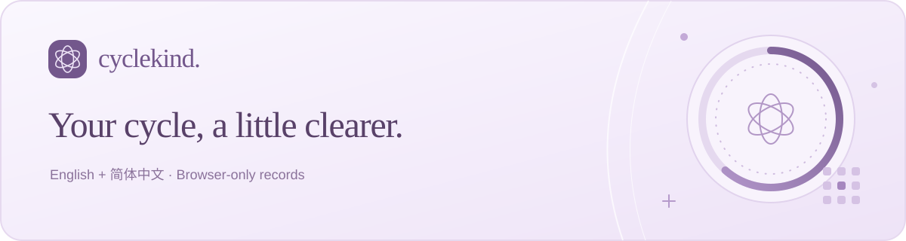
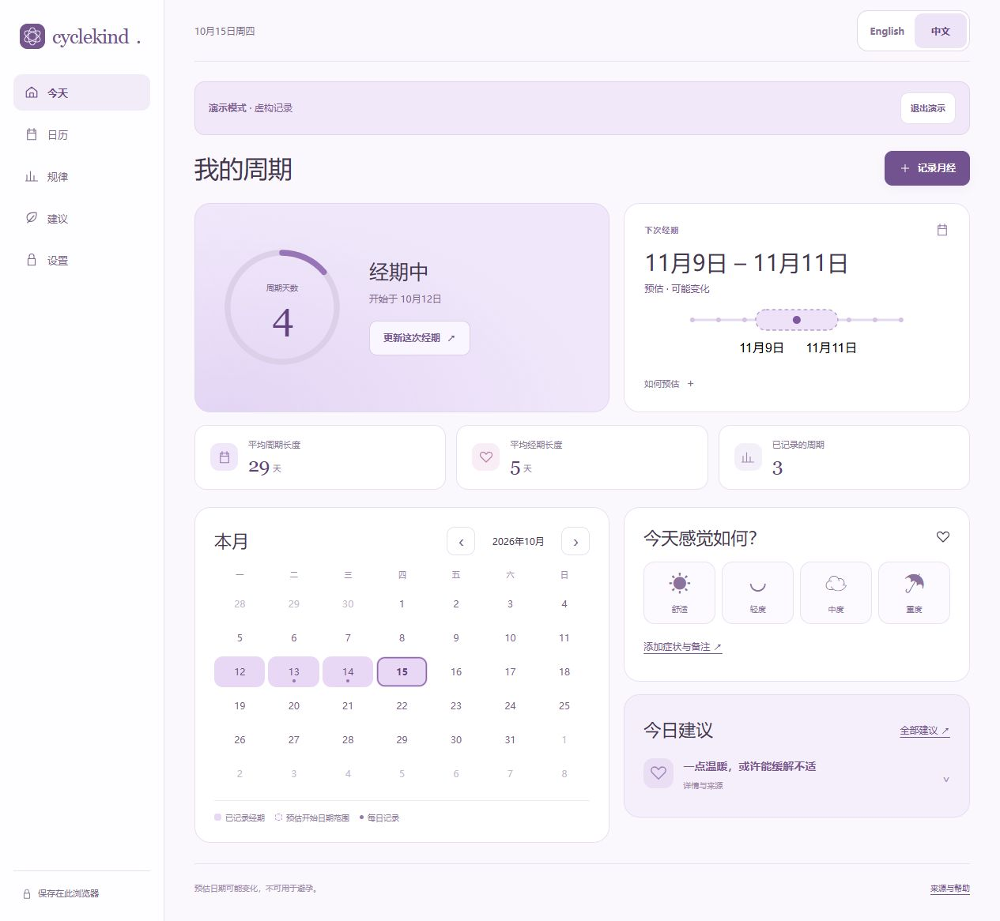
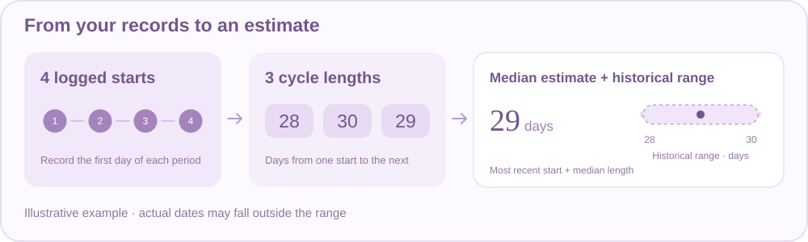
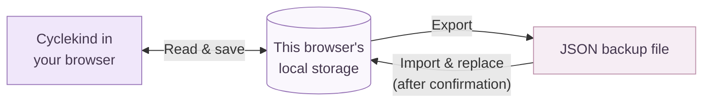

<p align="center">
  
</p>

<p align="center">
  Track periods, notice patterns, and estimate upcoming dates—in English or 中文.
</p>

<p align="center">
  <strong><a href="https://cycle-kind.oaken-mango-2441.chatgpt.site/">Open the live app ↗</a></strong>
  &nbsp; · &nbsp;
  <a href="#quick-start">Run it locally</a>
  &nbsp; · &nbsp;
  <a href="#where-your-records-live">Data & privacy</a>
</p>

## A glance at your cycle



*Simplified Chinese interface · fictional demo records. Switch between **English | 中文** in the header.*

| | Make space for… | What you can do |
| :---: | --- | --- |
| 🗓️ | **A clearer calendar** | Log periods, including an ongoing period, and see the next estimated date range. |
| 📊 | **Patterns you can see** | Explore cycle-length bars and symptom frequencies from your own check-ins. |
| 🌿 | **A little useful guidance** | Open brief tips, their sources, and guidance on when to seek care. |
| 📁 | **Control of your records** | Export/import a backup, pause estimates, or try fictional demo data. |

## How estimates work



Estimates start after **four recorded period starts** and use up to **six recent cycles**. The range describes recorded history; actual dates can fall outside it.

> This calendar method is **not clinically validated**. Do not use it for contraception or diagnosis.

<details>
<summary>See the calculation and its limits</summary>

1. Measure the days between consecutive recorded period starts.
2. Take the median of the latest six available intervals, rounded to a whole day.
3. Add that length to the most recent actual start for the next-start estimate.
4. Use the shortest and longest of those intervals for the displayed range.

The range is **not a statistical confidence interval**. A passed estimate stays in place until you log another actual period; the app does not invent later periods.

Estimates are withheld when paused, when records are invalid, or when a recent interval is below 15 days, above 90 days, or the recent spread exceeds 20 days. These are software heuristics, not diagnostic or normality thresholds. The app does not predict fertile days or confirm ovulation.

</details>

## Quick start

With **Node.js 20+**, no package installation is needed:

```sh
git clone https://github.com/ChrystalFSC/cyberkind.git
cd cyberkind
node server.mjs
```

Open **[127.0.0.1:4173](http://127.0.0.1:4173)**. Choose **Try demo** to explore without adding personal records.

| Command | What it does |
| --- | --- |
| `npm test` | Runs the date-engine and storage tests. |
| `npm run build` | Copies the static app into `dist/`. |

<details>
<summary>Hosting and development notes</summary>

Serve `dist/` over HTTPS when hosting. The app uses vanilla HTML, CSS, and JavaScript modules with no runtime dependencies.

Use the same browser profile and site address to return to your saved records. A localhost copy, a hosted copy, and another device each have separate browser storage.

</details>

## Where your records live



Your period dates, symptoms, and notes stay in the current browser. The app has **no record-upload endpoint, analytics, or AI calls**.

**Export before changing devices, browsers, or site addresses—or clearing browser data.** Browser storage and exported backups are not encrypted by the app; keep backups somewhere private.

<details>
<summary>More about storage and recovery</summary>

- Anyone with access to your browser profile may be able to view its records. Private browsing may erase records when closed.
- Imports are validated and replace the current records only after confirmation.
- Corrupt or inaccessible storage pauses ordinary writes to avoid silently overwriting existing data. Explicit import/reset controls support recovery.
- Demo records stay in memory, separate from personal records. Demo edits disappear on exit or reload.
- Content Security Policy blocks app API connections. App assets still load from the host, and external source links open their publishers' websites.

</details>

## Guidance with sources

Tips link to [NHS](https://www.nhs.uk/symptoms/period-pain/), [ACOG](https://www.acog.org/womens-health/faqs/abnormal-uterine-bleeding), and the [U.S. Office on Women's Health](https://womenshealth.gov/menstrual-cycle/your-menstrual-cycle). Sources were checked on **8 October 2026**; this is source checking, not clinical review or endorsement.

The information supports general understanding. A healthcare professional can assess symptoms and changes that concern you.

<details>
<summary>Inside the project</summary>

| File | Purpose |
| --- | --- |
| [`app.js`](app.js) | Screens, check-ins, calendar, and charts. |
| [`cycle-engine.js`](cycle-engine.js) | Calendar arithmetic, record validation, and estimates. |
| [`storage.js`](storage.js) | Browser storage, backup validation, export, and import. |
| [`health-content.js`](health-content.js) | Bilingual guidance and linked sources. |
| [`i18n.js`](i18n.js) | English / Simplified Chinese interface text. |
| [`styles.css`](styles.css) | Responsive lavender theme. |

</details>
